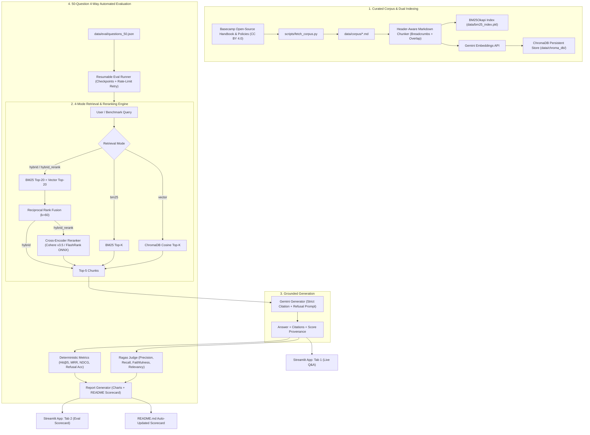

# Measured RAG — Hybrid-Search RAG with Automated Evaluation

## Goal Description

Build a portfolio-grade, **8GB-RAM-friendly** specialized Q&A assistant (**"Measured RAG"**) over real, curated open-source corporate policies, combining **BM25 keyword search**, **ChromaDB vector search**, **Reciprocal Rank Fusion (RRF)**, and **Cross-Encoder Reranking**, rigorously benchmarked across a **fixed 50-question stratified evaluation suite** with a **4-way ablation scorecard** rendered in both a **Streamlit Dashboard** and `README.md`.

### Agreed Design Decisions
- **Knowledge Base (Curated, Not Fabricated):** Real, open-source corporate policies curated from Basecamp/37signals' public GitHub repositories (`basecamp/handbook` + `basecamp/policies`), licensed under **CC BY 4.0** with full attribution (`ATTRIBUTION.md`). Covers HR, Benefits & Perks, Vacation/PTO, Expenses, Travel, Titles/Salaries, Sabbaticals, Moonlighting, Code of Conduct, Security, Privacy, GDPR, and Abuse/Compliance policies (~25–30 clean Markdown documents).
- **LLM & Embeddings (0 MB Local RAM):** Google Gemini API (`google-genai` SDK) with model names configurable in `.env` (e.g., `GEMINI_MODEL=gemini-2.5-flash-lite` or user's preferred Flash Lite model ID, and `GEMINI_EMBEDDING_MODEL=gemini-embedding-001`).
- **Cross-Encoder Reranker (8GB-RAM-Safe):**
  - **Primary:** Cohere Rerank API (`rerank-v3.5`, free trial tier — 1,000 calls/month, 0 MB local RAM) when `COHERE_API_KEY` is present in `.env`.
  - **Automatic Fallback:** FlashRank (`ms-marco-MiniLM-L-12-v2` via lightweight ONNX Runtime, ~34 MB weights, **zero PyTorch**) if `COHERE_API_KEY` is omitted or disabled.
- **Evaluation Benchmark:** 50 manually verified questions stratified across 4 categories (`keyword_exact`, `conceptual_paraphrased`, `nuanced_exception`, `unanswerable_trap`), running a **full 4-way ablation**:
  1. `bm25` (Keyword Baseline)
  2. `vector` (ChromaDB Dense Embeddings Baseline)
  3. `hybrid` (BM25 + Vector via RRF)
  4. `hybrid_rerank` (Full System: BM25 + Vector RRF + Cross-Encoder Reranking)
- **Metrics Measured:**
  - **Deterministic Retrieval Metrics (instant, exact):** `Hit Rate@5`, `MRR@5`, `NDCG@5` (scored against ground-truth policy document IDs on the 42 answerable questions).
  - **Ragas LLM-as-a-Judge Metrics:** `Context Precision`, `Context Recall`, `Faithfulness`, `Answer Relevancy`.
  - **Hallucination / Refusal Metric:** `Refusal Accuracy` on the 8 `unanswerable_trap` questions.
- **UI & Portfolio Artifacts:** Lightweight **Streamlit Dashboard** (Live Q&A with mode switcher, inline citations, chunk score breakdown, latency + Interactive Evaluation Scorecard tab) and automated export of PNG charts + Markdown Scorecard directly into `README.md`.

---

## Architecture Overview



---

## User Review Required

> [!IMPORTANT]
> **API Keys & Two-Phase Workflow:**
> 1. **Phase 1 (Immediate after approval):** Build the entire codebase, curate the real Basecamp Handbook + Policies corpus from GitHub, craft and verify all 50 ground-truth Q&A pairs against the exact curated files, and run full offline unit + mock integration tests (`pytest`).
> 2. **Phase 2 (Live Evaluation):** You will copy `.env.example` to `.env`, add your `GEMINI_API_KEY` (and optional `COHERE_API_KEY` — free trial from Cohere dashboard, or leave blank to use the 34 MB FlashRank ONNX fallback), and set your preferred `GEMINI_MODEL`. Then we will run ingestion, execute the live 50-question 4-way evaluation, and auto-populate `README.md` + charts with real verified metrics!

> [!NOTE]
> **8GB RAM Optimization:**
> We intentionally **exclude `torch` and `sentence-transformers`** from `requirements.txt` so installation stays fast and memory usage stays well under ~300 MB RAM even while running Streamlit + ChromaDB + FlashRank ONNX.

---

## Proposed Changes

### Project Directory Layout

```text
d:\Rag_with_automated_evaluation\
├── .env.example
├── .gitignore
├── requirements.txt
├── README.md
├── app.py                              # Streamlit Dashboard (Live Q&A + Eval Scorecard)
├── assets/                             # Auto-generated PNG charts for README
│   ├── ablation_scorecard.png
│   └── category_breakdown.png
├── data/
│   ├── corpus/                         # Curated real Basecamp Handbook & Policies (.md)
│   │   └── ATTRIBUTION.md              # CC BY 4.0 license & source links
│   ├── eval/
│   │   ├── questions_50.json           # Fixed 50-question stratified benchmark
│   │   └── results/                    # Resumable checkpoints & aggregated metrics JSON/CSV
│   ├── chroma_db/                      # Persisted ChromaDB vector index (gitignored)
│   └── bm25_index.pkl                  # Persisted BM25 index (gitignored)
├── scripts/
│   ├── fetch_corpus.py                 # Downloads & cleans curated CC BY 4.0 policy files
│   ├── build_index.py                  # Chunks corpus & builds ChromaDB + BM25 indexes
│   ├── run_eval.py                     # CLI for resumable 4-way ablation + Ragas evaluation
│   └── generate_report.py              # Builds charts & updates README.md scorecard
├── src/
│   ├── __init__.py
│   ├── config.py                       # Pydantic settings loaded from .env
│   ├── schemas.py                      # Typed dataclasses/Pydantic models (Chunk, RetrievedChunk, RAGResponse)
│   ├── ingestion/
│   │   ├── loader.py                   # Reads corpus markdown + YAML/metadata
│   │   └── chunker.py                  # Header-aware Markdown chunker with section breadcrumbs
│   ├── retrieval/
│   │   ├── embeddings.py               # Gemini Embeddings API client with batching & retry
│   │   ├── bm25_store.py               # BM25Okapi index + policy-aware tokenizer
│   │   ├── vector_store.py             # ChromaDB persistent store wrapper
│   │   ├── reranker.py                 # Pluggable Cohere v3.5 API + FlashRank ONNX fallback
│   │   └── hybrid.py                   # Unified 4-mode Retriever (bm25 / vector / hybrid / hybrid_rerank) + RRF
│   ├── generation/
│   │   └── generator.py                # Grounded Gemini generator with citation & refusal instructions
│   ├── pipeline.py                     # End-to-end MeasuredRAGPipeline orchestrator
│   └── evaluation/
│       ├── retrieval_metrics.py        # Hit Rate@K, MRR@K, NDCG@K, Refusal Accuracy
│       ├── ragas_eval.py               # Ragas evaluator configured with Gemini + rate-limit safety
│       ├── runner.py                   # Resumable 4-way benchmark runner with per-question checkpointing
│       └── report.py                   # Markdown scorecard table + Matplotlib PNG chart exporter
└── tests/
    ├── test_chunker.py
    ├── test_retrieval.py
    ├── test_metrics.py
    └── test_pipeline_mock.py
```

---

### Component 1: Project Configuration & Schemas

#### [NEW] `requirements.txt`
Lightweight, PyTorch-free dependencies suitable for Python 3.12 on an 8GB RAM Windows laptop:
- `google-genai` (official Gemini SDK for generation + embeddings)
- `chromadb` (local persistent vector database)
- `rank-bm25` (BM25Okapi keyword retriever)
- `cohere` (Cohere v5 `ClientV2` for `rerank-v3.5` API)
- `flashrank` (ultra-light ~34 MB ONNX cross-encoder fallback)
- `ragas` + `datasets` + `langchain-google-genai` (automated RAG evaluation; supports both native `google-genai` and LangChain adapter for version stability)
- `pydantic`, `pydantic-settings`, `python-dotenv`, `tenacity` (config + robust rate-limit retries)
- `streamlit`, `plotly`, `matplotlib`, `pandas` (dashboard & README chart generation)
- `httpx`, `pytest` (corpus fetching & automated tests)

#### [NEW] `.env.example` & `.gitignore`
`.env.example` exposes all configurable knobs clearly:
```env
GEMINI_API_KEY=your_gemini_api_key_here
GEMINI_MODEL=gemini-2.5-flash-lite
GEMINI_EMBEDDING_MODEL=gemini-embedding-001

# Optional: Free Trial Cohere API key for 0-RAM cloud reranking (rerank-v3.5)
# Leave blank to automatically use local FlashRank ONNX (~34MB, no PyTorch)
COHERE_API_KEY=
RERANKER_PROVIDER=auto

# Retrieval & Evaluation Tuning
TOP_K_CANDIDATES=20
TOP_K_FINAL=5
RRF_K=60
EVAL_REQUEST_DELAY_SEC=2.0
```
`.gitignore` excludes `.env`, `.venv/`, `__pycache__/`, `data/chroma_db/`, `data/bm25_index.pkl`, `.pytest_cache/`, while **keeping** `data/corpus/`, `data/eval/questions_50.json`, `data/eval/results/summary.json`, and `assets/*.png` version-controlled for recruiter reproducibility.

#### [NEW] `src/config.py` & `src/schemas.py`
Centralized `Settings` class (`pydantic-settings`) and clean Pydantic models:
- `DocumentChunk`: `chunk_id`, `doc_id`, `doc_title`, `section_path`, `text`, `source_url`, `token_count`
- `RetrievedChunk`: wraps `DocumentChunk` with provenance fields (`bm25_score`, `bm25_rank`, `vector_score`, `vector_rank`, `rrf_score`, `rerank_score`, `final_rank`)
- `RAGResponse`: `query`, `mode`, `answer`, `citations`, `retrieved_chunks`, `is_refusal`, `latency_ms` (`retrieval_ms`, `rerank_ms`, `generation_ms`, `total_ms`)

---

### Component 2: Real Corpus Curation & Header-Aware Ingestion

#### [NEW] `scripts/fetch_corpus.py`
Fetches a curated set of ~25 real, substantive Markdown policy files directly from GitHub (`basecamp/handbook` and `basecamp/policies`), strips minimal Jekyll/Liquid frontmatter while preserving clean Markdown headings, writes `data/corpus/*.md` with standardized YAML metadata (`doc_id`, `title`, `category`, `source_repo`, `source_url`, `license: CC BY 4.0`), and generates `data/corpus/ATTRIBUTION.md`.

#### [NEW] `src/ingestion/loader.py` & `src/ingestion/chunker.py`
- Parses each Markdown document into structural sections (`#`, `##`, `###`).
- Splits long sections cleanly on paragraph/sentence boundaries (~350–450 words max, ~50-word overlap) while prepending a context breadcrumb header to every chunk:
  ```text
  [Document: Benefits and Perks | Section: Vacation & Paid Time Off]
  ...chunk body...
  ```
- **Why this matters:** Prepending document & section breadcrumbs dramatically improves both BM25 matching (e.g., queries mentioning "vacation" or "security") and Cross-Encoder reranking, and gives exact source citations!

---

### Component 3: Hybrid Retrieval & Cross-Encoder Reranking Engine

#### [NEW] `src/retrieval/embeddings.py`
Wrapper around `google.genai.Client().models.embed_content(...)` with:
- Proper `task_type` (`RETRIEVAL_DOCUMENT` when indexing, `RETRIEVAL_QUERY` when querying)
- Batched requests + `tenacity` exponential backoff for rate limits
- Deterministic abstract `EmbeddingProvider` interface so tests can inject a fast mock embedder without network calls

#### [NEW] `src/retrieval/bm25_store.py`
- Uses `rank_bm25.BM25Okapi`.
- Policy-aware tokenizer: lowercases text, strips punctuation cleanly while **preserving policy-critical tokens** such as dollar amounts (`$5,000` -> `5000`, `$5000`), percentages (`10%`), numbers/durations (`30`, `401k`), and hyphenated compliance terms (`gdpr`, `soc-2`, `ccpa`).
- Persists tokenized corpus & chunk metadata to `data/bm25_index.pkl`.

#### [NEW] `src/retrieval/vector_store.py`
- Uses `chromadb.PersistentClient(path="data/chroma_db")` with `hnsw:space="cosine"`.
- Stores chunk text, Gemini embeddings, and metadata (`doc_id`, `doc_title`, `section_path`, `source_url`).
- Converts Chroma cosine distance $d$ to similarity score $1 - d$.

#### [NEW] `src/retrieval/reranker.py`
Pluggable `BaseReranker` interface with factory `create_reranker(settings)`:
1. **`CohereReranker`**: Uses `cohere.ClientV2(api_key=...).rerank(model="rerank-v3.5", query=..., documents=..., top_n=...)` with retry/backoff.
2. **`FlashRankReranker`**: Uses `flashrank.Ranker(model_name="ms-marco-MiniLM-L-12-v2")` (ONNX Runtime, ~34 MB, no PyTorch).
3. **`auto` mode**: Selects `CohereReranker` if `COHERE_API_KEY` is configured, else transparently falls back to `FlashRankReranker`.

#### [NEW] `src/retrieval/hybrid.py`
Implements **Reciprocal Rank Fusion (RRF)** and unified 4-mode retrieval (`bm25`, `vector`, `hybrid`, `hybrid_rerank`):
- For each candidate chunk $c$ in the union of BM25 top-$N$ and Vector top-$N$:
  $$\text{RRF}(c) = \frac{w_{\text{bm25}}}{k + \text{rank}_{\text{bm25}}(c)} + \frac{w_{\text{vec}}}{k + \text{rank}_{\text{vec}}(c)}$$
  (default $k=60$, $w_{\text{bm25}} = 0.5$, $w_{\text{vec}} = 0.5$).
- In `hybrid_rerank` mode, passes the top-20 RRF candidates to the Cross-Encoder Reranker and returns the top-5 reranked chunks with all intermediate ranks and scores attached for full transparency in the Streamlit UI and evaluation logs!

---

### Component 4: Grounded Generation & Pipeline Orchestrator

#### [NEW] `src/generation/generator.py` & `src/pipeline.py`
- System prompt enforces:
  1. Answer **strictly** from the provided policy excerpts — never invent policies, numbers, or exceptions.
  2. Cite every factual claim inline using `[Doc Title > Section]`.
  3. **Explicit Refusal Protocol:** If the retrieved context does not contain the answer, respond starting with: `"I cannot find this information in the provided company handbook or policies."` (enabling accurate automated Refusal Accuracy measurement on the 8 `unanswerable_trap` questions!).
- `MeasuredRAGPipeline` ties together Retriever + Generator and records per-stage latency (`retrieval_ms`, `rerank_ms`, `generation_ms`, `total_ms`).

---

### Component 5: 50-Question Stratified Benchmark Dataset

#### [NEW] `data/eval/questions_50.json`
After fetching the real Basecamp Handbook & Policies corpus in Phase 1, we will inspect the actual curated files and construct **50 verified ground-truth Q&A entries** (no guesswork — every answer & `expected_doc_ids` grounded directly in the fetched `.md` files):
- **15 `keyword_exact` questions:** Exact figures, stipends, durations, forms, specific policy terms/clauses.
- **15 `conceptual_paraphrased` questions:** Everyday employee phrasings that do not share exact vocabulary with the policy text.
- **12 `nuanced_exception` questions:** Eligibility thresholds, conditional rules, edge cases, or distinctions between two policies.
- **8 `unanswerable_trap` questions:** Realistic corporate policy questions (e.g., "What is the company's pet insurance reimbursement limit?", "How do I apply for an H-1B visa sponsorship?", "What is the dress code for client visits?") that are **verified absent** from the curated corpus, with `is_answerable: false`.

Schema per item:
```json
{
  "id": "Q01",
  "category": "keyword_exact",
  "is_answerable": true,
  "question": "...",
  "ground_truth_answer": "...",
  "expected_doc_ids": ["benefits-and-perks"],
  "expected_evidence_snippet": "..."
}
```

---

### Component 6: Automated Evaluation & README Report Generator

#### [NEW] `src/evaluation/retrieval_metrics.py`
Pure-Python deterministic IR metrics (unit-tested for mathematical exactness):
- `hit_rate_at_k(retrieved_doc_ids, expected_doc_ids, k=5)`
- `mrr_at_k(retrieved_doc_ids, expected_doc_ids, k=5)`
- `ndcg_at_k(retrieved_doc_ids, expected_doc_ids, k=5)`
- `refusal_accuracy(is_refusal_pred, is_answerable)` on trap questions

#### [NEW] `src/evaluation/ragas_eval.py`
Configures **Ragas** to use the user's Gemini LLM + Gemini Embeddings (with rate-limit concurrency control `RunConfig(max_workers=2, max_retries=5)` and delay throttling so free-tier quotas don't crash the run):
- Evaluates `ContextPrecision`, `ContextRecall`, `Faithfulness`, and `AnswerRelevancy` on the 42 answerable questions.

#### [NEW] `src/evaluation/runner.py` & `scripts/run_eval.py`
- Runs all 4 modes (`bm25`, `vector`, `hybrid`, `hybrid_rerank`) across the 50 questions (also supports `--configs` and `--limit` CLI flags for quick smoke tests or incremental runs).
- **Resumable Checkpointing:** Writes each completed `(config, question_id)` result immediately to `data/eval/results/checkpoints/<config>.jsonl`. If interrupted or rate-limited, re-running skips already completed questions automatically!
- Saves aggregated results to `data/eval/results/summary.json` and per-question details to `data/eval/results/detailed_results.csv`.

#### [NEW] `src/evaluation/report.py` & `scripts/generate_report.py`
- Generates two crisp, publication-grade charts in `assets/`:
  1. `assets/ablation_scorecard.png` — Grouped bar chart showing metric progression across `BM25` → `Vector` → `Hybrid (RRF)` → `Hybrid + Rerank`.
  2. `assets/category_breakdown.png` — Hit Rate@5 / MRR@5 broken down by question category (`Keyword`, `Paraphrased`, `Nuanced Exception`) proving *why* Hybrid + Rerank wins across every category!
- Auto-updates the Markdown Accuracy Scorecard table and key highlight callout (e.g., *"Improved Hit Rate@5 from X% to Y% and Context Precision from A% to B% by adding hybrid RRF + cross-encoder reranking"*) between `<!-- SCORECARD:START -->` and `<!-- SCORECARD:END -->` in `README.md`.

---

### Component 7: Interactive Streamlit Dashboard

#### [NEW] `app.py`
Clean, lightweight Streamlit UI with 2 tabs:
1. **Live Policy Q&A Assistant:**
   - Sidebar controls: Retrieval Mode selector (`BM25 Only`, `Vector Only`, `Hybrid (RRF)`, `Hybrid + Rerank`), `Top-K` slider, Reranker status badge (Cohere vs FlashRank), plus clickable sample questions from each category (including a Hallucination Trap demo!).
   - Main panel: Grounded answer with formatted citations, latency breakdown chips (`Retrieval | Rerank | Generation`), and an expandable **Retrieval Transparency Inspector** showing each retrieved chunk's BM25 rank/score, Vector rank/score, RRF score, and Cross-Encoder Rerank score side-by-side!
2. **Evaluation Scorecard Dashboard:**
   - Displays the 4-way Ablation Scorecard table with delta highlights vs baseline.
   - Interactive Plotly grouped bar charts (Overall Metrics + Category Breakdown).
   - **Per-Question Diff Inspector:** Filter by category or pick any of the 50 questions to compare what `BM25` vs `Vector` vs `Hybrid + Rerank` retrieved and answered!

---

## Verification Plan

### Phase 1 Automated Tests (Before Live API Keys)
1. Install dependencies into a clean project virtual environment (`.venv`) and confirm lightweight install (no `torch`).
2. Run corpus curation script and verify ~25–30 real CC BY 4.0 policy `.md` files + `ATTRIBUTION.md` are cleanly fetched and non-empty:
   ```powershell
   .\.venv\Scripts\python.exe scripts\fetch_corpus.py
   ```
3. Verify all 50 benchmark questions validate cleanly against the curated corpus (`expected_doc_ids` exist in `data/corpus/`, exact category counts = 50).
4. Run full `pytest` unit & mock integration suite:
   ```powershell
   .\.venv\Scripts\python.exe -m pytest -v
   ```
   Covers:
   - Header-aware Markdown chunking & breadcrumb preservation (`test_chunker.py`)
   - Policy-aware BM25 tokenizer, ChromaDB vector retrieval with mock embeddings, RRF fusion math, and pluggable reranker routing (`test_retrieval.py`)
   - Deterministic IR metrics (`Hit@K`, `MRR@K`, `NDCG@K`, `Refusal Accuracy`) exact math (`test_metrics.py`)
   - End-to-end mock pipeline, checkpoint resume logic, and report/chart generation (`test_pipeline_mock.py`)

### Phase 2 Live End-to-End Verification (After Adding API Keys to `.env`)
1. Build real ChromaDB + BM25 indexes using Gemini Embeddings API:
   ```powershell
   .\.venv\Scripts\python.exe scripts\build_index.py
   ```
2. Run a 2-question live smoke test first to confirm Gemini model ID, Cohere/FlashRank reranker, and Ragas integration work smoothly:
   ```powershell
   .\.venv\Scripts\python.exe scripts\run_eval.py --limit 2
   ```
3. Run the full 50-question 4-way ablation evaluation & generate charts + `README.md` scorecard:
   ```powershell
   .\.venv\Scripts\python.exe scripts\run_eval.py
   .\.venv\Scripts\python.exe scripts\generate_report.py
   ```
4. Manual UI Verification: Launch Streamlit and verify both tabs (Live Q&A with mode switching + citations + chunk score inspector, and Evaluation Scorecard tab with real 50-question charts):
   ```powershell
   .\.venv\Scripts\streamlit.exe run app.py
   ```
